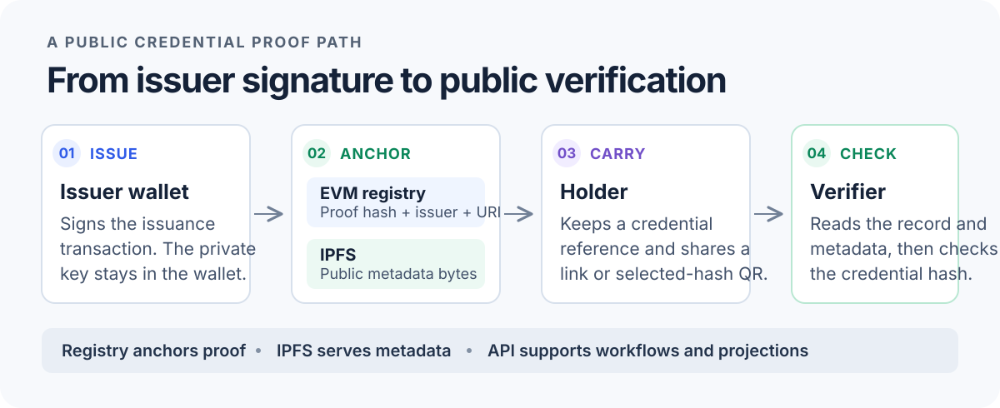

# Credora

Issue skills and certifications that holders can carry, share, and verify against public proof.

<p align="center">
  <a href="https://credora-gules.vercel.app/">Open Credora</a> ·
  <a href="docs/setup/local-development.md">Run it locally</a> ·
  <a href="docs/architecture/overview.md">System architecture</a>
</p>

<p align="center">
  <picture>
    <source media="(max-width: 600px)" srcset="./assets/readme/credential-proof-path-mobile.svg" />
    
  </picture>
</p>

Credora connects issuing organizations, credential holders, and independent verifiers. A verifier can check a credential from its public link or QR code without creating an account or connecting a wallet.

## Proof and data

| Source           | What it establishes                                                                                                                            |
| ---------------- | ---------------------------------------------------------------------------------------------------------------------------------------------- |
| **EVM registry** | Credential proof and issuer authorization. The registry is authoritative for the recorded credential fields.                                   |
| **IPFS**         | Public metadata bytes addressed by a content identifier (CID). The CID is not the credential hash.                                             |
| **API + SQLite** | Sessions, organization workflows, sharing, audit records, and chain-derived projections. The projections can be rebuilt from registry history. |

Credential hashes use versioned Keccak-256. Issued v1 credentials are immutable. Keep private keys and unnecessary personal data out of public metadata. Credora does not ship a seeded credential catalog; public verification and issuance need reachable, configured registry and metadata services.

## Run locally

Requirements: **Node.js 22.12 or newer** and **pnpm 10.32.1**.

```sh
corepack enable
corepack prepare \
  pnpm@10.32.1 --activate
pnpm install --frozen-lockfile
[ -f .env.local ] ||
  cp .env.example .env.local
[ -f apps/web/.env.local ] ||
  cp .env.example \
    apps/web/.env.local
pnpm dev
```

Open <http://localhost:3000>. The API listens on port `4000`. The web app can start without a wallet or local chain, but chain-backed verification and issuance need a configured registry and metadata gateway. Follow the [local development guide](docs/setup/local-development.md) for environment details, or the [blockchain guide](docs/setup/blockchain.md) to run Anvil and deploy local registries.

## Workspaces

- `apps/web` — public verification, issuer and organization workspaces, holder wallet, and administration.
- `apps/api` — wallet sessions, organization workflows, sharing, audit, and chain-backed verification.
- `contracts` — Solidity credential registries and Foundry scripts.
- `packages/*` — shared protocol, hashing, storage, auth, blockchain, and UI modules.

## Project checks

```sh
pnpm typecheck
pnpm lint
pnpm test
pnpm build
```

Contract checks require Foundry; API integration checks also require Anvil. See [contract development](contracts/README.md) and the [blockchain guide](docs/setup/blockchain.md).

## Guides

- [All setup guides](docs/setup/README.md) — local development, blockchain, user roles, production, and troubleshooting.
- [Architecture overview](docs/architecture/overview.md) — system boundaries and sources of truth.
- [Protocol decisions](docs/decisions/) — credential formats, issuer authority, and sharing rules.
- [Self-hosted deployment](deploy/README.md) — domains, TLS, persistent storage, and backups.
