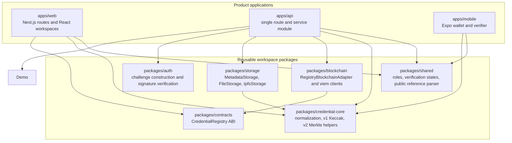
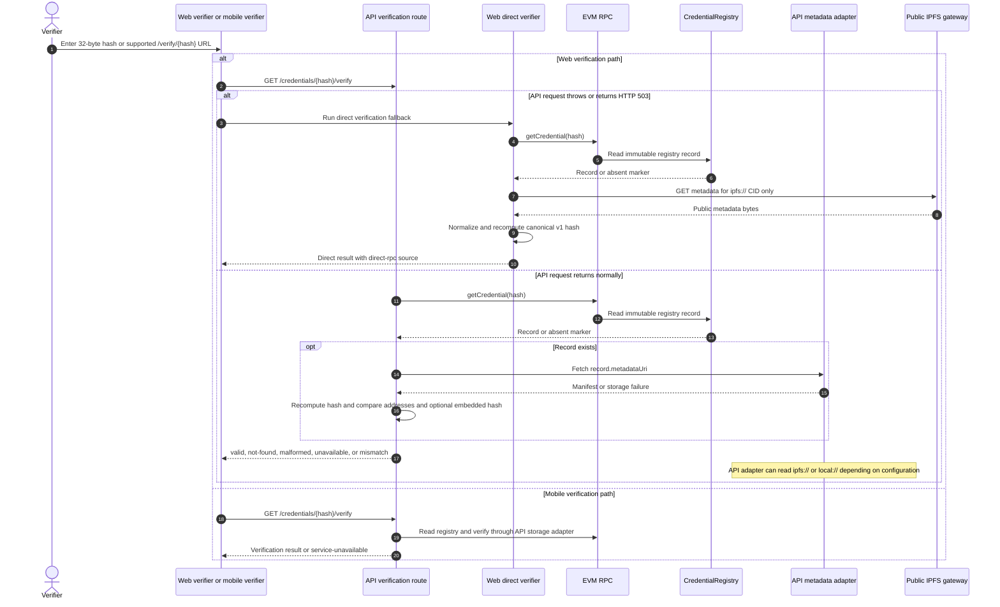
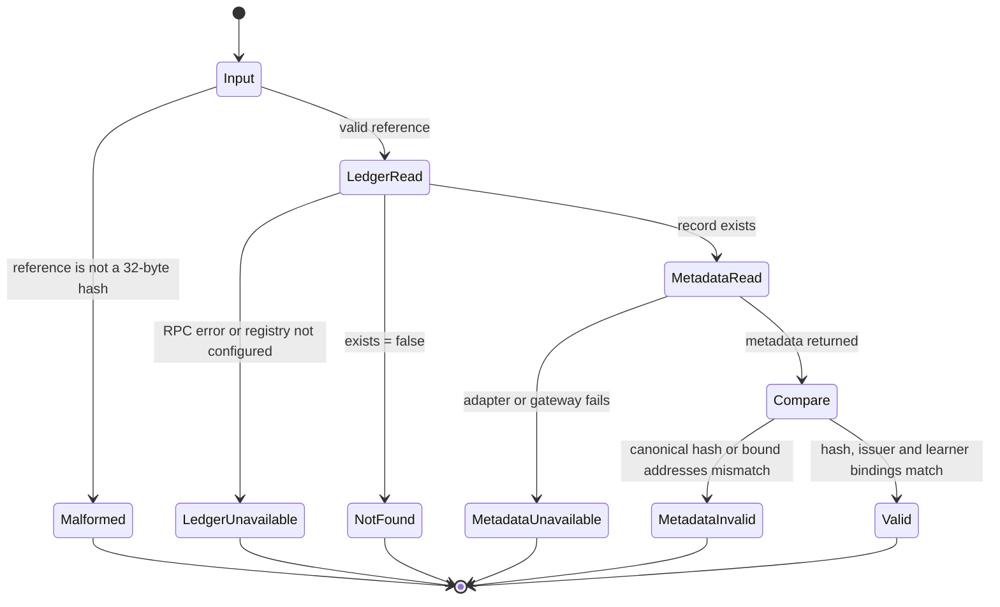
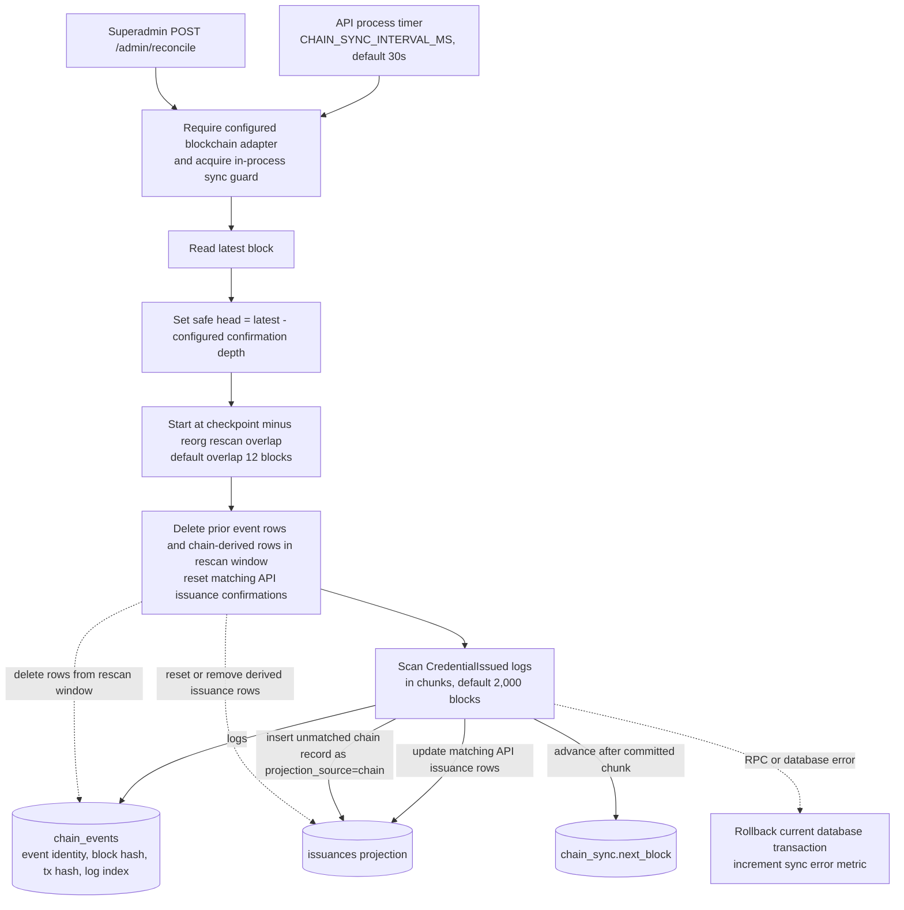
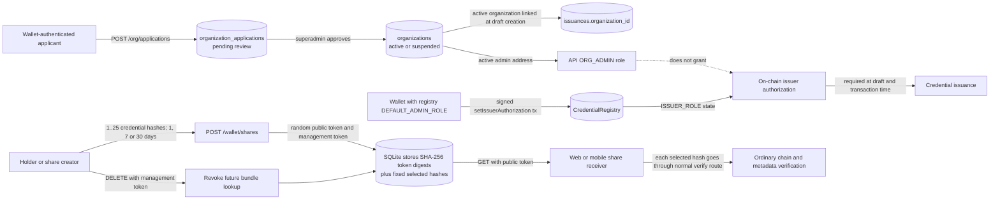
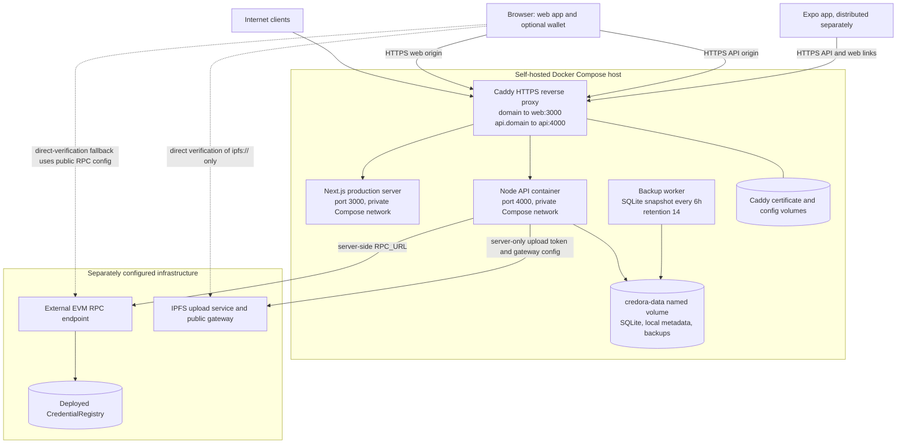

# Credora software architecture diagrams

These diagrams describe the implementation in this repository. They are
written in Mermaid inside Markdown so the source remains reviewable and
editable alongside the code.

## 1. Runtime boundaries and trust model

```mermaid
flowchart LR
  subgraph People[People and client devices]
    Issuer[Issuer or organization admin]
    Holder[Credential holder]
    Verifier[Public verifier]
    Browser[Browser wallet extension]
    Mobile[Expo mobile app]
  end

  subgraph Web[Web runtime: Next.js]
    IssuerUI[Issuer and organization workspaces]
    AdminUI[Superadmin workspace]
    PublicUI[Public verification and share pages]
    BrowserVerify[Direct verification fallback<br/>browser RPC plus public IPFS gateway]
  end

  subgraph ApiRuntime[API runtime: one Node HTTP process]
    Routes[Route dispatch, validation, sessions, roles, rate limits]
    Auth[Wallet challenge and signature verification]
    Issuance[Issuance workflow and receipt checks]
    Verify[Registry and metadata verification]
    Share[Fixed selection share capabilities]
    Sync[Timed chain-event reconciliation]
    Sql[(SQLite<br/>sessions, operations, org access,<br/>audit, shares, event and issuance projections)]
    StorageAdapter[MetadataStorage adapter]
  end

  subgraph Packages[Workspace packages]
    Shared[@credora/shared<br/>states, roles, hash-reference parsing]
    Core[@credora/credential-core<br/>canonical v1 hash and metadata normalization<br/>plus package-level v2 claims helpers]
    Blockchain[@credora/blockchain<br/>viem registry adapter]
    ContractAbi[@credora/contracts<br/>registry ABI]
    AuthPkg[@credora/auth<br/>challenge message and signature checks]
    StoragePkg[@credora/storage<br/>file and IPFS adapters]
  end

  subgraph External[External proof infrastructure]
    Rpc[Configured EVM RPC]
    Registry[(CredentialRegistry<br/>proof and issuer-role authority)]
    Ipfs[(IPFS upload endpoint and gateway)]
    Disk[(API metadata directory<br/>when IPFS is not configured)]
  end

  Issuer --> IssuerUI
  Holder --> PublicUI
  Verifier --> PublicUI
  Browser -->|personal_sign and transaction approval| IssuerUI
  Mobile -->|HTTPS API requests| Routes
  IssuerUI -->|HTTPS API requests| Routes
  AdminUI -->|HTTPS API requests| Routes
  PublicUI -->|API-first verification| Routes
  PublicUI -.->|on API network error or HTTP 503| BrowserVerify
  BrowserVerify --> Rpc
  BrowserVerify --> Ipfs

  Routes --> Auth
  Routes --> Issuance
  Routes --> Verify
  Routes --> Share
  Routes --> Sync
  Routes --> Sql
  BrowserVerify -. uses .-> Core
  BrowserVerify -. uses .-> ContractAbi
  Issuance --> StorageAdapter
  Verify --> StorageAdapter
  Sync --> Sql
  StorageAdapter -->|IPFS when upload and gateway URLs are configured| Ipfs
  StorageAdapter -->|otherwise: local:// metadata| Disk
  Issuance -->|role, transaction, and record reads| Blockchain
  Verify -->|getCredential| Blockchain
  Sync -->|block height and CredentialIssued logs| Blockchain
  Blockchain --> ContractAbi
  Blockchain --> Rpc
  Rpc --> Registry

  Routes -. uses .-> Shared
  Auth -. uses .-> AuthPkg
  Issuance -. hash and normalize .-> Core
  Verify -. hash and normalize .-> Core
  Blockchain -. address and ABI types .-> Shared
  StorageAdapter -. implements .-> StoragePkg
  Mobile -. uses .-> Shared
  Mobile -. uses .-> Core

  classDef authoritative fill:#e8f5e9,stroke:#2e7d32,color:#102a13;
  classDef projection fill:#fff3e0,stroke:#ef6c00,color:#3e2600;
  classDef client fill:#e3f2fd,stroke:#1565c0,color:#10233a;
  class Registry,Ipfs authoritative;
  class Sql projection;
  class IssuerUI,AdminUI,PublicUI,Mobile,Browser client;
```

### Boundary notes

- The chain registry is authoritative for credential existence, issuer,
  learner, metadata URI, issuance time, issuer authorization, and registry-admin
  authorization. SQLite and the API are operational services and projections.
- The registry stores a versioned Keccak-256 credential hash. The IPFS CID
  addresses metadata bytes; it is not the credential hash.
- The API selects `IpfsStorage` only when both `IPFS_UPLOAD_URL` and
  `IPFS_GATEWAY_URL` are set. Otherwise it selects `FileStorage`, which writes
  `local://` metadata under `API_STORAGE_PATH`.
- The web verifier attempts the API first. It calls browser-side direct
  verification when the API request throws or returns HTTP 503. Direct browser
  verification supports `ipfs://` metadata via its configured public gateway;
  it does not read the API's `local://` filesystem.
- The mobile verifier calls the API and reports an API service-unavailable
  state if that request fails. It does not contain the web app's direct RPC
  fallback.
- Apps depend on workspace packages. Shared packages do not depend on either
  app.

## 2. Implemented module and dependency map



`apps/api/src/index.ts` currently owns HTTP route dispatch, security checks,
SQLite operations, issuance orchestration, metadata retrieval, verification,
and chain synchronization in one process/module. The diagram deliberately
shows the implemented module boundary rather than implying separate
controllers, services, workers, or microservices. `@credora/ui` exists as a
package, but it is not a dependency of the web, API, or mobile package manifests;
the inspected web surfaces compose app-local UI components. Browser-side web
verification uses viem directly with the shared contracts ABI rather than the
API's `RegistryBlockchainAdapter`.

## 3. Issuance and wallet authentication

```mermaid
sequenceDiagram
  autonumber
  actor Issuer
  participant Web as Web issuer workspace
  participant Wallet as Browser wallet
  participant API as API route process
  participant DB as SQLite
  participant Store as IPFS or local file adapter
  participant RPC as EVM RPC
  participant Registry as CredentialRegistry

  Issuer->>Web: Connect issuer account
  Web->>API: POST /auth/challenge {address}
  API->>DB: Store nonce, signed-message template, expiry
  API-->>Web: Challenge message
  Web->>Wallet: personal_sign(challenge)
  Wallet-->>Web: Signature (private key remains in wallet)
  Web->>API: POST /auth/verify {address, signature}
  API->>DB: Consume one-time challenge
  API->>RPC: Read issuer/admin roles when configured
  API->>DB: Store expiring session and audit authentication
  API-->>Web: Session token, address, roles, expiry

  Issuer->>Web: Enter learner and credential fields
  Web->>API: POST /issuances (Bearer session)
  API->>RPC: Check session address has ISSUER_ROLE
  API->>DB: Insert draft (and active organization ID when applicable)
  API-->>Web: Draft ID and normalized operation details
  Web->>API: POST /issuances/{id}/metadata
  API->>Store: Write schemaVersion 1 manifest
  Store-->>API: metadata URI and storage identifier
  API->>API: Normalize fields and Keccak-256 hash canonical v1 payload
  API->>DB: Save URI, hash, metadata-uploaded state, audit entry
  API-->>Web: Credential hash and metadata URI

  Web->>Wallet: Request issueCredential(hash, learner, URI)
  Wallet->>RPC: Submit signed transaction
  RPC->>Registry: Check ISSUER_ROLE and immutably store record
  Registry-->>RPC: CredentialIssued event and receipt
  RPC-->>Wallet: Transaction hash
  Wallet-->>Web: Transaction hash
  Web->>API: POST /issuances/{id}/confirm {txHash, hash}
  API->>RPC: Wait receipt; decode transaction; read registry record
  API->>API: Compare sender, hash, learner, URI, issuer and on-chain values
  API->>DB: Mark confirmed and append audit entry
  API-->>Web: Confirmed issuance projection
```

The API checks issuer authorization before draft creation and the contract
checks it again when the wallet submits the transaction. Organization approval
only creates an API-side `ORG_ADMIN` access record; it does not grant
`ISSUER_ROLE`. The issuer's wallet is the transaction signer. The API verifies
that confirmed transaction data matches the draft before marking its
operational row confirmed.

The v1 manifest is uploaded before the transaction, because its metadata URI
is part of the v1 hash. A failed transaction can therefore leave unreferenced
metadata. The credential itself is immutable after issuance; edits, revocation,
and correction are not implemented in the current contract.

## 4. Verification, trust, and failure paths





The API is a verifier implementation, not the proof authority. A successful
verification requires a registry record plus metadata whose canonical,
versioned Keccak-256 hash matches that record's reference and whose issuer and
learner addresses match the chain. A database row or API response alone is not
proof. API failure is not a failed proof. In v1, public metadata contains the
full credential claims needed to recompute the hash.

## 5. Chain-event projection and reorganization handling



`reconcileChainEvents` runs in the API process; there is no separate indexer
worker. It scans only to the configured safe head, uses bounded block ranges,
and rescans an overlap so events in a recent reorganization can be replaced.
Rows discovered from chain events can be recreated. API-created drafts keep
their source rows and may be reset to their pre-confirmed operation state if
their projected block is in the rescan range. Organization applications,
approvals, sessions, shares, and audit records are operational API data, not
reconstructed from chain events. `/credentials` and dashboards read SQLite
projections; `/credentials/{hash}/verify` reads the registry and metadata.

## 6. Organization roles and selected-share capabilities



Organization application review controls website workspace access and
organization profile projection only. The registry independently authorizes
the wallet that submits every issuance. Wallet shares are bearer capabilities
for retrieving a fixed list of public hashes: the API stores token digests,
and management-token validation permits revocation. Expiry or revocation
blocks future bundle lookup but cannot erase public registry records or copies
already retrieved. A share does not prove control of the learner wallet.

## 7. Production deployment topology



Compose includes the web server, API, Caddy, and backup worker. It does not
deploy an EVM node, registry contract, IPFS node, or mobile binary. The API's
upload token is server-side; `NEXT_PUBLIC_*` RPC, registry, API, and gateway
settings are browser-visible. Caddy routes the API on the separate `api.`
hostname. `/readyz` is used for the API health check. The API volume also
contains local metadata when file storage is selected.

## Code map used for these diagrams

| Concern | Implementation |
| --- | --- |
| API initialization, routes, roles, SQLite operations, verification, projection sync | [`apps/api/src/index.ts`](../../apps/api/src/index.ts) |
| SQLite schema and migrations | [`apps/api/src/migrations.ts`](../../apps/api/src/migrations.ts) |
| Web issuer workflow and browser wallet submission | [`apps/web/src/components/issuer-workspace.tsx`](../../apps/web/src/components/issuer-workspace.tsx) |
| Web wallet session | [`apps/web/src/lib/wallet-session.ts`](../../apps/web/src/lib/wallet-session.ts) |
| API-first web verification and fallback selection | [`apps/web/src/lib/verification-api.ts`](../../apps/web/src/lib/verification-api.ts) |
| Web direct registry and IPFS-gateway verification | [`apps/web/src/lib/direct-verification.ts`](../../apps/web/src/lib/direct-verification.ts) |
| Mobile API-only verification and share helpers | [`apps/mobile/src/credentials.ts`](../../apps/mobile/src/credentials.ts) |
| Canonical credential hash and selective-disclosure helpers | [`packages/credential-core/src/index.ts`](../../packages/credential-core/src/index.ts) |
| EVM registry adapter and ABI | [`packages/blockchain/src/index.ts`](../../packages/blockchain/src/index.ts), [`packages/contracts/src/index.ts`](../../packages/contracts/src/index.ts) |
| Metadata storage adapters | [`packages/storage/src/index.ts`](../../packages/storage/src/index.ts) |
| Immutable record and issuer roles | [`contracts/src/CredentialRegistry.sol`](../../contracts/src/CredentialRegistry.sol) |
| Deployment, proxy, persistence, and backup topology | [`deploy/docker-compose.yml`](../../deploy/docker-compose.yml), [`deploy/Caddyfile`](../../deploy/Caddyfile), [`scripts/backup-sqlite.mjs`](../../scripts/backup-sqlite.mjs) |

## Implementation scope visible in the diagrams

The Solidity registry and ordinary product verification flow implement v1
public-manifest credentials. `credential-core` contains v2 selective-disclosure
hash and Merkle proof helpers, but the normal issuance path, API verification,
web direct verification, and mobile metadata parser shown above are v1 flows.
Do not interpret the v2 package helpers as an integrated end-user protocol.
