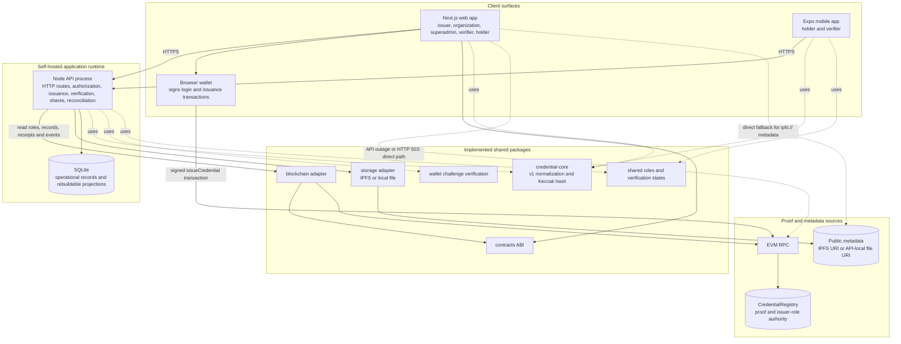
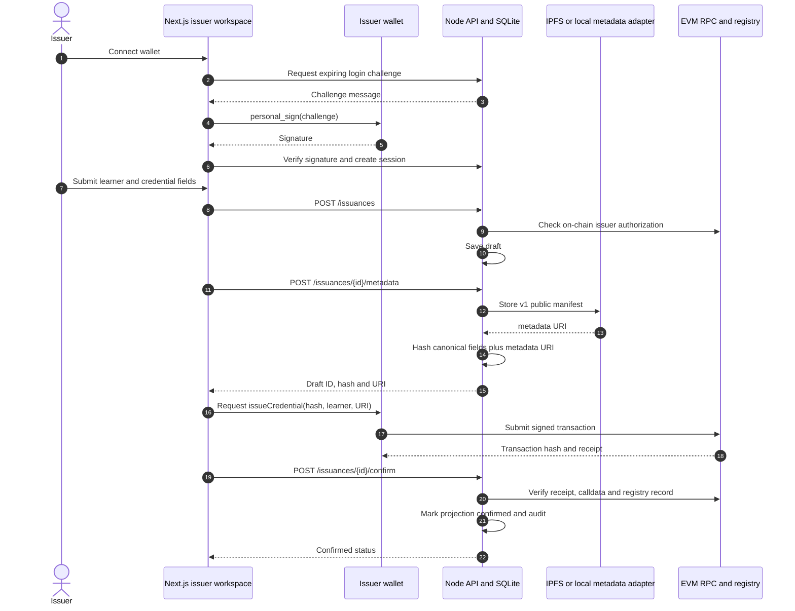

# Credora project presentation

Content follows the six sections in `Project Presentation Template.pptx`.
Replace the cover placeholders with the presenters' names and team number.
Architecture diagrams are editable Mermaid blocks in this Markdown file. The
deeper implementation map and operational diagrams are in
[`docs/architecture/diagrams.md`](../docs/architecture/diagrams.md).
For the plain-language system explanation and likely Q&A, see
[`presentation/project-explained.md`](project-explained.md).

## Slide 1 — Project title

### Credora
**Portable credentials with independently verifiable proof**

Presented by: **[Group member names]**<br>
Indian Institute of Information Technology Kottayam<br>
Team number: **[Team number]**

*Keep the cover minimal. Add names and team number before presenting.*

## Slide 2 — Introduction

### What Credora does

Credora gives organizations a way to issue digital credentials, holders a way to carry and share them, and verifiers a public way to check their authenticity.

- A registry contract anchors each credential hash and its issuer, learner, metadata URI, and issue time.
- Public metadata carries the credential details. A verifier recomputes the hash to check that those details match the registry.
- The API supports sessions, issuer workflows, scoped credential and issuance lists, audit, organization access, and temporary sharing. Its chain-derived records can be rebuilt.
- Web and mobile interfaces support holders and verifiers. Issuance and administration run on the web.

**Implementation status:** Core web issuance and verification have implemented code paths. The full product is not release-complete: native device checks and authenticated organization workflow evidence remain open. Selective disclosure is implemented in the shared protocol package, but is not wired into the end-user issuance and verification flows.

**Presenter cue:** Credora separates proof from product conveniences. A verifier can check public proof without trusting a Credora account or database.

**Evidence:** `apps/web/src/components/issuer-workspace.tsx`, `apps/api/src/index.ts`, `contracts/src/CredentialRegistry.sol`, `apps/mobile/App.tsx`, `packages/credential-core/src/index.ts`.

## Slide 3 — Problem statement and objectives

### Problem

Credentials kept in a single institution's database are difficult to carry between services and difficult for an outside verifier to check independently. A database outage or a changed record can also leave the verifier unsure whether a credential is invalid or simply unavailable.

### Objectives

1. Let an authorized issuer create a credential whose proof can be checked against a public registry.
2. Let a holder share a public credential reference without giving an issuer or verifier a private key.
3. Let a verifier distinguish a missing credential, an invalid proof, and unavailable infrastructure.
4. Keep the application API replaceable for chain-derived data while retaining the operational records the product needs.
5. Limit public metadata to credential information needed for verification.

### Scope boundary

Issued v1 credentials are immutable. The current contract has no revocation or correction mechanism. Organization approval grants operational website access; it does not prove legal identity or authorize a wallet to issue on-chain.

**Evidence:** `contracts/src/CredentialRegistry.sol`, `apps/api/src/index.ts`, `apps/web/src/lib/verification-api.ts`, `apps/web/src/lib/direct-verification.ts`.

## Slide 4 — Requirements: functional and non-functional

### Functional requirements and implementation

| Requirement | Implemented behavior |
| --- | --- |
| Wallet authentication | API issues a nonce challenge; the browser wallet signs it; the API verifies the signature and creates an expiring session. |
| Issuer authorization | The registry admin grants the on-chain issuer role. The API checks that role before it creates an issuance draft. |
| Credential issuance | Web flow creates a draft, stores metadata, computes the hash, asks the wallet to submit the registry transaction, then checks its receipt and stored record. |
| Public verification | Verifier reads the registry, loads metadata, recomputes the versioned hash, and checks issuer and learner bindings. |
| Holder sharing | Web and mobile can share public links; a selected set can be shared through a fixed, expiring QR bundle. Each credential still receives an ordinary proof check. |
| Operations and roles | API supports organization applications and review, role-gated dashboards, audit records, chain-event projection and reconciliation. |
| Mobile holder/verifier | Expo app stores public references locally, scans credential or share QR codes, calls the verification service, and exports public JSON. |

### Non-functional requirements

- **Proof integrity:** Keccak-256 over canonical, versioned fields. An IPFS CID identifies metadata bytes; it is not the credential hash.
- **Privacy:** Signing keys stay in the user's wallet. Avoid unnecessary personal information in public metadata.
- **Honest failure states:** Malformed input, absent record, ledger outage, metadata outage, and proof mismatch have distinct results.
- **Replaceable projections:** Chain-derived issuance rows can be reconstructed from registry events; organization applications and access decisions remain API records.
- **Self-hosting:** Local Anvil and file storage support development; production Compose config provides web, API, HTTPS proxy, SQLite volume, and scheduled backups.

### Completion check

The core web proof path is implemented. End-to-end organization application/review evidence and native device QA remain open. v2 selective-disclosure helpers have package-level implementation, but normal issuance, API verification, web direct verification, and mobile metadata parsing currently follow the v1 public-manifest format. The repository contains unit and integration suites for hashing, storage, contracts, API routes, roles, outages, and selected shares; release evidence for the open workflows is still needed.

**Evidence:** `packages/credential-core/src/index.ts`, `apps/api/src/index.ts`, `apps/mobile/src/credentials.ts`, `tests/e2e/`, `docs/ux/finish-review.md`.

## Slide 5 — System architecture

### Component and trust boundaries



The API is implemented as one Node process and route module. SQLite contains
sessions, organization access, audit data, shares, issuance operations, and
chain-derived projections. The registry and metadata bytes remain the public
proof sources. The API chooses IPFS only when upload and gateway URLs are both
configured; otherwise it stores local metadata. The mobile verifier is API-only;
the web verifier has a direct RPC/gateway fallback. See the
[detailed architecture diagrams](../docs/architecture/diagrams.md) for exact
fallback conditions, module dependencies, deployment topology, and projection
recovery behavior.

### Issuance sequence



The API checks authorization and validates the transaction, but the issuer's
wallet signs and sends it. Organization approval grants API workspace access;
the registry separately enforces `ISSUER_ROLE`.

### Verification and source of truth

```mermaid
sequenceDiagram
  autonumber
  actor Verifier
  participant Client as Web or mobile verifier
  participant API as Credora API
  participant Browser as Web direct verifier
  participant RPC as EVM RPC and registry
  participant Store as Metadata adapter or IPFS gateway

  Verifier->>Client: Submit a 32-byte hash or /verify/{hash} URL
  Client->>API: GET /credentials/{hash}/verify
  alt API returns a result
    API->>RPC: Read registry record
    API->>Store: Fetch metadata URI
    API->>API: Recompute v1 hash and compare issuer and learner
    API-->>Client: valid, not-found, malformed, unavailable or mismatch
  else Web API request throws or returns HTTP 503
    Client->>Browser: Start direct fallback
    Browser->>RPC: Read registry record directly
    Browser->>Store: Fetch ipfs:// metadata via public gateway
    Browser->>Browser: Recompute v1 hash and compare bound addresses
    Browser-->>Client: direct result
  else Mobile API request fails
    Note over Client: Show service-unavailable; the credential is not marked invalid
  end
```

The direct fallback is a web capability only. The mobile app uses the API and
reports service unavailability when it cannot reach it. Verification requires
an existing registry record and metadata whose canonical v1 Keccak hash and
issuer/learner bindings match. The detailed document also diagrams all
individual verification states, API projection rebuilding, organization roles,
share capabilities, and production deployment.

**Authority:** The registry anchors credential existence, issuer, learner, metadata URI, issue time, and issuer authorization. IPFS supplies the bytes for the URI. The API database projects chain events and stores operational records; it cannot replace the chain proof.

**Important boundaries:** The web issuer signs the issuance transaction in the user's wallet; private keys do not enter the API. `ORG_ADMIN` is an API-reviewed access role, separate from the on-chain issuer role. Temporary share codes resolve a fixed list of public hashes and do not prove that the presenter controls a learner wallet. v2 Merkle selective disclosure exists in `credential-core`; the registry interface and production user flows currently issue and verify v1 records.

**Evidence:** `apps/web/src/components/issuer-workspace.tsx`, `apps/api/src/index.ts`, `apps/api/src/migrations.ts`, `packages/blockchain/src/index.ts`, `packages/storage/src/index.ts`, `contracts/src/CredentialRegistry.sol`, `apps/web/src/lib/direct-verification.ts`, `apps/web/src/lib/verification-api.ts`. Detailed diagram-to-code map: [`docs/architecture/diagrams.md`](../docs/architecture/diagrams.md).

## Slide 6 — Demonstration

### Suggested live walkthrough

1. **Show the product surface.** Open `/` and verify a public credential QR or link against the configured registry and metadata source.
2. **Issue a real local credential.** Start Anvil, deploy `CredentialRegistry`, authorize a test issuer, and configure the API and web app for that registry. Connect the issuer wallet at `/issuer`, enter a learner address and credential fields, upload metadata, then approve the wallet transaction.
3. **Verify independently.** Open the resulting `/verify/<credential-hash>` link. Show the registry-bound result and public metadata. If configured, use direct RPC plus the IPFS gateway to demonstrate verification outside the API.
4. **Show holder sharing.** Open `/wallet`, copy a public credential link or create a selected, expiring share QR. Scan it with the mobile app or show the `/share/<token>` receiver. Explain that every hash is verified separately and that a QR does not authenticate its presenter.
5. **Show a failure state.** Demonstrate malformed input, an absent hash, or a deliberately unavailable registry/gateway. The verifier keeps service failures separate from proof mismatch.

### Setup and evidence notes

- A real issuance walkthrough needs Anvil, a deployed registry, a funded local test wallet, and working metadata storage. Local file storage supports an API-backed walkthrough; configure IPFS upload and gateway settings to demonstrate direct verification outside the API.
- Native camera scanning, file sharing, accessibility, and safe-area behavior need Android/iOS device or emulator checks before claiming mobile release readiness.
- The organization applicant QR and superadmin approval flow is implemented in source, but should be presented as a workflow preview until the authenticated application, review, suspension, and registry-backed issuance paths receive end-to-end validation.

**Evidence:** `docs/setup/blockchain.md`, `apps/web/src/components/verify-form.tsx`, `apps/web/src/components/issuer-workspace.tsx`, `apps/mobile/App.tsx`, `tests/e2e/`.
